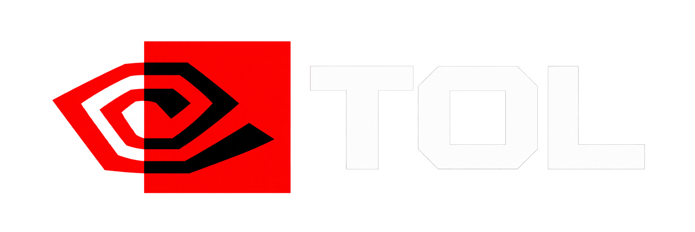

# The Ominous Linux (TOL)

> Linux, without the cheerful marketing.

  

> The TOL mark is inspired by the visual language of the band TOOL. TOL is not
> affiliated with, endorsed by, or connected to TOOL, its members or its
> management.

**The Ominous Linux** — **TOL** — is the group behind camareLOL and the projects
that grow out of it. It is not a distribution, and it does not have a company
behind it. It is a name for a way of building Linux tooling: state the risk,
show the evidence, and never claim a result that was not verified.

| | |
|---|---|
| Short name | TOL |
| Projects | [camareLOL](../README.md), [LOL kernel](LOL-KERNEL.md) |
| Repository | <https://github.com/TOL-the-ominous-linux/camareLOL> |
| Landing page | <https://github.com/TOL-the-ominous-linux/.github> — the organisation profile repository |
| Status | brand and documentation, October 2026 |

## Why "ominous"

Because the honest version of a Linux tool sounds ominous at first: *this will
erase the disk*, *this package does not exist*, *your firmware will not boot
this*. camareLOL says those things before it acts. TOL is the name for that
habit, not for a theme.

The eye in the mark is the part that watches: the installer that re-reads the
disk before writing, the self-test that refuses to claim success, the release
script that verifies its own checksums.

## Projects

### camareLOL

A safety-first TUI installer for Arch Linux, written in Rust. Discovery → plan →
review → confirm → execute → verify, with a safety gate in front of every
destructive operation. Vietnamese, English and Simplified Chinese.

- Current release: see [README.md](../README.md) and
  [docs/releases](../docs/releases).
- npm: `@wenker-ai/camarelo`.
- It installs Arch Linux. It is not a distribution and does not ship a kernel.

### LOL kernel

The kernel line that camareLOL installs, or offers to install, when a machine
needs more than the stock Arch kernel. Arch-based, built as normal packages, no
out-of-tree surprises. **Planned; nothing is shipped yet.** The
[LOL kernel repository](https://github.com/TOL-the-ominous-linux/kernel) holds
the policy and the patch set;
[LOL-KERNEL.md](LOL-KERNEL.md) is the definition and the current state.

## Naming

| Written | Means |
|---|---|
| `TOL`, `The Ominous Linux` | the group |
| `camareLOL` | the installer (one `m`, then `are`) |
| `LOL kernel`, `linux-lol` | the kernel line; package names use `linux-lol` |
| `LOL` alone | avoid it — it reads as "laughing out loud" outside this context |

`camareLOL` is the spelling used by the binary, the npm package, the tag names
and the documentation. The local working directory on the author's machine is
`carameLOL` — that is a typo in a folder name, not a second product.

## Brand

See [BRAND.md](BRAND.md) for the mark, the colours, what may be reused, and the
attribution line that must travel with the logo.

## Contributing

TOL has no contributor programme yet. Issues and discussions for camareLOL live
in the camareLOL repository. If you want to work on the kernel line, start at
<https://github.com/TOL-the-ominous-linux/kernel> and read
[LOL-KERNEL.md](LOL-KERNEL.md) first: the constraints there are the project.

## License

Documentation in this directory is GPL-3.0-or-later, like the rest of the
repository. The TOL name and mark are not granted for endorsement; see
[BRAND.md](BRAND.md).
